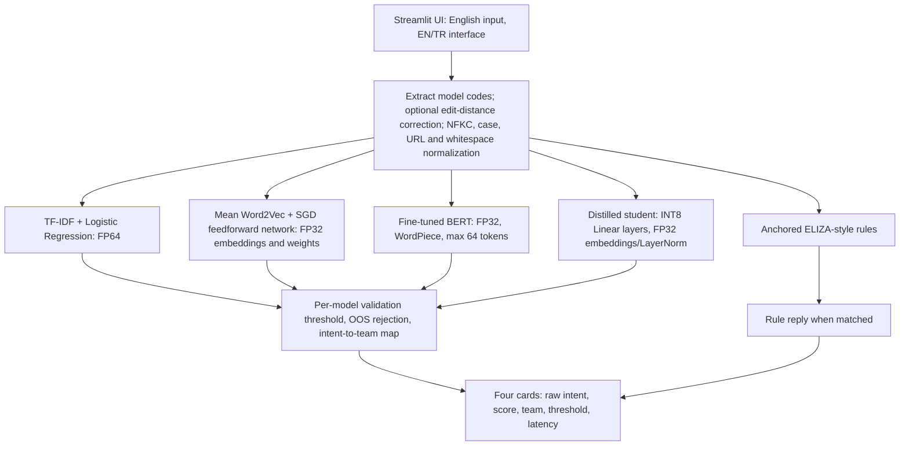

# Architecture and technique map

## Runtime data flow

All runtime components execute locally on the CPU. Models load once through Streamlit's resource cache.
Predictions run sequentially under a lock, with one numeric thread. Results persist in session state when the interface language changes.
If a small-talk rule matches, its reply is the application response and model cards are diagnostic comparisons.
Each model has its own team recommendation; no ensemble or hidden fifth classifier combines the four predictions.
Neural inputs with no known tokens are rejected by a rule and have no confidence score.
The diagram groups decisions for readability; code implements them in `src/routing.py`, `src/inference.py` and `app/streamlit_app.py`.

## Training and evaluation

CLINC150 splits: 15,095 train / 3,100 validation / 5,500 test.
Local CPU trains TF-IDF/LR and Word2Vec/MLP. Colab T4 fine-tunes BERT and distills the smaller student.
The teacher is frozen during distillation. The student objective is 0.5 CE + 0.5 T² KL(teacher || student), T=2.
Local CPU converts student Linear layers to dynamic INT8, reloads the artifact and checks probability equivalence.
Validation selects checkpoints and rejection thresholds; held-out test data is used for final metrics.
Training bundles exclude test data. All four test hashes match.

## Technique map

| Area | Technique | Concrete component | Evidence |
|---|---|---|---|
| A: neural networks | SGD, backpropagation, mean embeddings, feedforward network | Word2Vec 100d; 256/128 ReLU hidden layers | `scripts/train_neural.py`, `src/models/neural.py` |
| B: classical NLP | TF-IDF word 1–2 grams, Logistic Regression; regex, minimum edit distance, ELIZA-style rules | Baseline and application preprocessing/rules | `scripts/train_baseline.py`, `src/preprocessing.py`, `src/routing.py` |
| C: Transformers | BERT fine-tuning, self-attention, WordPiece tokenization | BERT intent head over 151 labels | `scripts/train_bert.py`, `src/inference.py` |
| D: efficient models | Knowledge distillation, dynamic INT8 quantization, CPU benchmarking | Smaller 4-layer student; INT8 Linear layers | `src/models/distillation.py`, `scripts/train_student.py`, `scripts/quantize_student.py` |

## Scope and measurement limits

Team labels are application mappings, not CLINC150 ground truth. Only English messages are supported.
Optional spelling correction and small-talk rules are not included in the classifier test metrics.
The downloadable INT8 artifact expects the onednn backend. Only Windows x86-64 has been checked.
Report the FP32 student alongside INT8 when discussing quantization: this isolates quantization from distillation.
The INT8 student was smaller but slightly slower than the FP32 student in the recorded CPU benchmark.
